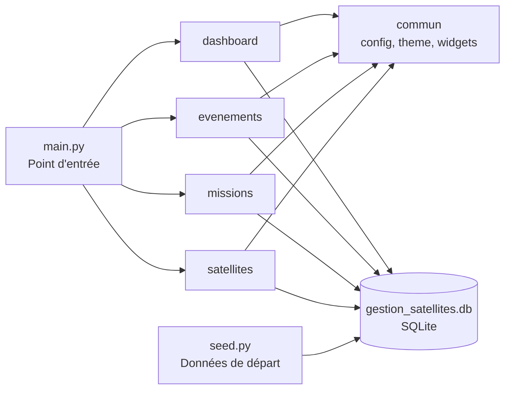
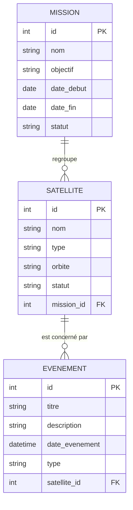

# SatGuard - Gestion des missions des satellites.

Application de bureau permettant de gérer des satellites, les missions auxquelles ils sont rattachés et les événements qui les concernent,
avec une base de données locale SQLite et une interface graphique.

## 📋 Table des matières

- [À propos du projet](#à-propos-du-projet)
- [Fonctionnalités](#fonctionnalités)
- [Architecture](#architecture)
- [Stack Technique](#stack-technique)
- [Installation et Lancement](#installation-et-lancement)
- [Guide d'utilisation](#guide-dutilisation)
- [Copyright et Licence](#copyright-et-licence)

---

## À propos du projet

SatGuard est un projet réalisé dans le cadre du module de **Programmation Orientée Objet (POO)**. Il centralise la gestion de satellites, de missions et d'événements dans une même application, organisée en modules indépendants qui partagent une base de données commune.


## Fonctionnalités

- **Dashboard** : vue d'ensemble des données de l'application. [À COMPLÉTER : indicateurs affichés]
- **Satellites** : [ajouter, modifier, supprimer, consulter...]
- **Missions** : [À COMPLÉTER : créer une mission, lui rattacher des satellites...]
- **Événements** : [Consulter les événements...]
- Écran de démarrage et thème graphique commun à tous les modules.
- Base de données SQLite recréable avec des données de départ (`seed.py`).

## Architecture

### Structure des fichiers

```
satGuard/
├── commun/                  # Code partagé par tous les modules
│   ├── config.py            # Paramètres de l'application
│   ├── database.py          # Connexion et création des tables SQLite
│   ├── seed.py              # Remplit la base avec des données de départ
│   ├── theme.py             # Couleurs et style
│   └── widgets.py           # Composants d'interface réutilisables
├── dashboard/               # Tableau de bord
├── etudiant_evenements/     # Module  événements
├── etudiant_missions/       # Module missions
├── etudiant_satellites/     # Module  satellites
├── generateur_gui.py/       # genere les evenements 
├── main.py                  # Point d'entrée de l'app
└── .gitignore
```

Chaque module est un package Python indépendant. Tous s'appuient sur `commun/` pour la base de données et l'interface.

### Flux de l'application



### Modèle de données

> ⚠️ [À VÉRIFIER : ce schéma doit correspondre exactement aux `CREATE TABLE` de `commun/database.py`. Corrige les noms de tables, de colonnes et les relations si besoin.]



**Lecture des relations :**

| Relation | Cardinalité | Signification |
|---|---|---|
| MISSION - SATELLITE | 1,N | Une mission regroupe plusieurs satellites ; un satellite appartient à une seule mission. |
| SATELLITE - EVENEMENT | 1,N | pour un satellite on peut enregistrer plusieurs événements ; un événement concerne un seul satellite. |

**Dictionnaire des tables :**

| Table | Clé primaire | Clé étrangère | Rôle |
|---|---|---|---|
| `missions` | `id` | - | Stocke les missions. |
| `satellites` | `id` | `mission_id` → `missions.id` | Stocke les satellites rattachés à une mission. |
| `evenements` | `id` | `satellite_id` → `satellites.id` | Stocke les événements liés à un satellite. |

## Stack Technique

- **Langage** : Python 3.14.3
- **Paradigme** : Programmation Orientée Objet
- **Interface graphique** : Tkinter
- **Base de données** : SQLite
- **Autres bibliothèques** : commun, datetime, tkinter, 

## Installation et Lancement

```bash
git clone https://github.com/ndstepl/SatGuard.git
cd satguard

```

La base `gestion_satellites.db` n'est pas versionnée. Pour la créer avec des données de départ :

```bash
python -m commun.seed
```
Lancer l'application :

```bash
python main.py
```

## Guide d'utilisation

1. Lancer `python main.py` : l'écran de démarrage s'affiche, puis l'interface principale.
2. [À COMPLÉTER : comment naviguer entre dashboard, satellites, missions et événements.]
3. [À COMPLÉTER : comment ajouter, modifier ou supprimer un élément.]

## Copyright et Licence

Ce projet a été réalisé dans le cadre du module de **Programmation Orientée Objet (POO)** à des fins pédagogiques.

**Auteurs :**

- AOUSSAR Fatima
- BOULMANE Imane
- Chaimae

**Établissement / année :**  ENSAM CASA- UnivH2C

**Licence :** [À COMPLÉTER : MIT si tous les auteurs sont d'accord, avec un fichier `LICENSE` à la racine. Sinon : « Tous droits réservés, usage pédagogique ».]
