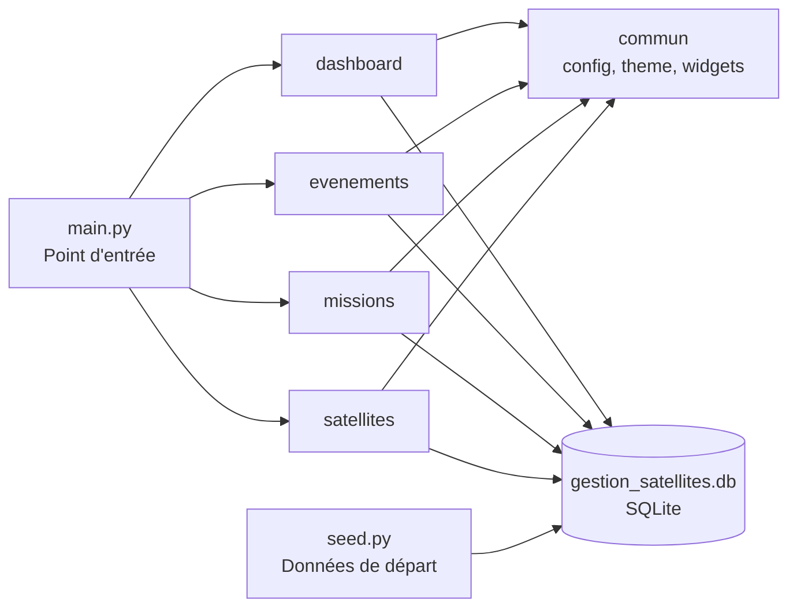

# SatGuard - Gestion des missions des satellites..


Application de bureau permettant de gérer des satellites, les missions auxquelles ils sont rattachés et les événements qui les concernent,
avec une base de données locale SQLite et une interface graphique.

## 📋 Table des matières

- [À propos du projet](#à-propos-du-projet)
- [Fonctionnalités](#fonctionnalités)
- [Architecture](#architecture)
- [Stack Technique](#stack-technique)
- [Installation et Lancement](#installation-et-lancement)
- [Guide d'utilisation](#guide-dutilisation)
- [Copyright et Licence](#copyright-et-licence)

---

## À propos du projet

SatGuard est un projet réalisé dans le cadre du module de **Programmation Orientée Objet (POO)**. Il centralise la gestion de satellites, de missions et d'événements dans une même application, organisée en modules indépendants qui partagent une base de données commune.


## Fonctionnalités

- **Dashboard** : vue d'ensemble des données de l'application. [À COMPLÉTER : indicateurs affichés]
- **Satellites** : [ajouter, modifier, supprimer, consulter...]
- **Missions** : [À COMPLÉTER : créer une mission, lui rattacher des satellites...]
- **Événements** : [Consulter les événements...]
- Écran de démarrage et thème graphique commun à tous les modules.
- Base de données SQLite recréable avec des données de départ (`seed.py`).

## Architecture

### Structure des fichiers

```
satGuard/
├── commun/                  # Code partagé par tous les modules
│   ├── config.py            # Paramètres de l'application
│   ├── database.py          # Connexion et création des tables SQLite
│   ├── seed.py              # Remplit la base avec des données de départ
│   ├── theme.py             # Couleurs et style
│   └── widgets.py           # Composants d'interface réutilisables
├── dashboard/               # Tableau de bord
├── etudiant_evenements/     # Module  événements
├── etudiant_missions/       # Module missions
├── etudiant_satellites/     # Module  satellites
├── generateur_gui.py/       # script python generant les evenements 
├── main.py                  # Point d'entrée de l'app
└── .gitignore
```

Chaque module est un package Python indépendant. Tous s'appuient sur `commun/` pour la base de données et l'interface.

### Flux de l'application



### Modèle de données

> ⚠️ [À VÉRIFIER : ce schéma doit correspondre exactement aux `CREATE TABLE` de `commun/database.py`. Corrige les noms de tables, de colonnes et les relations si besoin.]

```mermaid
erDiagram
    MISSION ||--o{ SATELLITE : "regroupe"
    SATELLITE ||--o{ EVENEMENT : "est concerné par"

    MISSION {
        int id PK
        string nom
        string objectif
        date date
        string agence
        string statut
    }

    SATELLITE {
        int id PK
        string nom
        string status
        float altitude
        float vitesse
        float inclinaison
        int mission_id FK
    }

    EVENEMENT {
        int id PK
        string description/ message
        datetime horodatage
        string type
        float batterie
        float temperature
        int satellite_id FK
    }
```

**Lecture des relations :**

| Relation | Cardinalité | Signification |
|---|---|---|
| MISSION - SATELLITE | 1,N | Une mission regroupe plusieurs satellites ; un satellite appartient à une seule mission. |
| SATELLITE - EVENEMENT | 1,N | pour un satellite on peut enregistrer plusieurs événements ; un événement concerne un seul satellite. |

**Dictionnaire des tables :**

| Table | Clé primaire | Clé étrangère | Rôle |
|---|---|---|---|
| `missions` | `id` | - | Stocke les missions. |
| `satellites` | `id` | `mission_id` → `missions.id` | Stocke les satellites rattachés à une mission. |
| `evenements` | `id` | `satellite_id` → `satellites.id` | Stocke les événements liés à un satellite. |

## Stack Technique

- **Langage** : Python 3.14.3
- **Paradigme** : Programmation Orientée Objet
- **Interface graphique** : Tkinter
- **Base de données** : SQLite
- **Autres bibliothèques** : commun, datetime, tkinter, 

## Installation et Lancement

```bash
git clone https://github.com/ndstepl/SatGuard.git
cd satguard

```

La base `gestion_satellites.db` n'est pas versionnée. Pour la créer avec des données de départ :

```bash
python -m commun.seed
```
Lancer l'application :

```bash
python main.py
```

## 🧭 Guide d'utilisation

Une fois l'application lancée (`python main.py`), voici comment naviguer dans l'interface :

1. **Tableau de bord (Accueil)** : Vue d'ensemble avec les statistiques globales, l'indice de santé de la flotte et les dernières alertes critiques.
2. 

3. **Missions** : Onglet pour créer, modifier ou supprimer une mission spatiale. Vous pouvez filtrer les missions par statut (En cours, Planifiée, Terminée).
4. 

5. **Satellites** : Liste de tous les satellites. Sélectionnez un satellite pour voir sa fiche technique, son score de santé et envoyer une commande (si son état le permet).
6. 

7. **Événements** : Historique complet des télémétries, alertes et commandes envoyées. Vous pouvez filtrer par date ou par type d'événement.
8. 


> 💡 **Astuce Démo** : Le flux de télémétrie est simulé en temps réel (chaque 2secondes )a partir du simulateur qui genere les evenements.
> 


## Copyright et Licence

Ce projet a été réalisé dans le cadre du module de **Programmation Orientée Objet (POO)** à des fins pédagogiques.

## Ameliorations futur envisagees

- Améliorations futures envisagées
- Intégration d'une API spatiale réelle (ex: N2YO) pour des positions orbitales en temps réel.
- Export des rapports de mission au format PDF.
- Passage complet à PostgreSQL pour un environnement de production multi-utilisateurs.

**Auteurs :**

- AOUSSAR Fatima
- BOULMANE Imane 
- BENHATA Chaimae

**Établissement / année :**  ENSAM CASA- UnivH2C

**Licence :** « Tous droits réservés, usage pédagogique »
